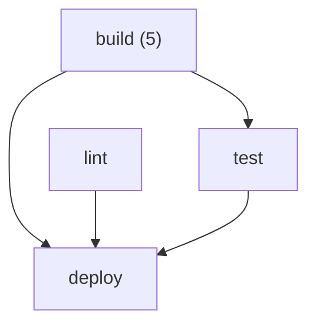

# gh-matrix-viz

[](https://github.com/moveeeax/gh-matrix-viz/actions/workflows/ci.yml)


Understand a sprawling GitHub Actions job matrix at a glance instead of reading YAML.
`gh-matrix-viz` parses a workflow file, expands `strategy.matrix` (with `include`
and `exclude`) into the concrete job combinations that will actually run, and
renders them as a Markdown table or a Mermaid dependency graph.

## Why

A three-axis matrix with an `include` and an `exclude` is a few lines of YAML
that fans out into a dozen jobs — and the exact set is genuinely hard to compute
in your head. GitHub's own expansion rules are subtle (an `include` entry merges
into existing combinations unless it would overwrite an original matrix value,
otherwise it becomes a brand-new job). This tool applies those exact rules so you
can see the real job list before you push.

## Install

```shell
pip install git+https://github.com/moveeeax/gh-matrix-viz.git
# or, from a clone:
pip install -e .
```

## Usage

```shell
gh-matrix-viz .github/workflows/ci.yml --format table   # Markdown table (default)
gh-matrix-viz .github/workflows/ci.yml --format graph   # Mermaid needs-graph
gh-matrix-viz .github/workflows/ci.yml --format both
gh-matrix-viz .github/workflows/ci.yml --job build      # one job only (repeatable)
cat ci.yml | gh-matrix-viz -                            # read from stdin
```

### Table output

For [`examples/ci.yml`](examples/ci.yml):

```
# CI

4 job(s), 8 concrete job combination(s).

## `build`

| # | os | py | coverage |
|---|---|---|---|
| 1 | ubuntu-latest | 3.9 |  |
| 2 | ubuntu-latest | 3.11 |  |
| 3 | ubuntu-latest | 3.12 | true |
| 4 | macos-latest | 3.11 |  |
| 5 | macos-latest | 3.12 |  |
```

`macos-latest` + `3.9` was dropped by `exclude`; the `include` added a `coverage`
column that only applies to `ubuntu-latest` + `3.12`.

### Graph output

`--format graph` emits a Mermaid diagram (renders inline on GitHub) with one node
per job — annotated with its combination count — and an edge for every `needs`:



## Matrix semantics

- Axes are the cartesian product of every `matrix` key that isn't `include`/`exclude`.
- `exclude` entries are partial matches removed from that product.
- `include` entries merge into existing combinations when they don't overwrite an
  original matrix value; otherwise they're appended as new combinations. Appended
  combinations are not merge targets for later `include` entries — matching
  GitHub's documented behaviour.

## Development

```shell
pip install -e ".[test]"
pytest
```

## License

MIT
